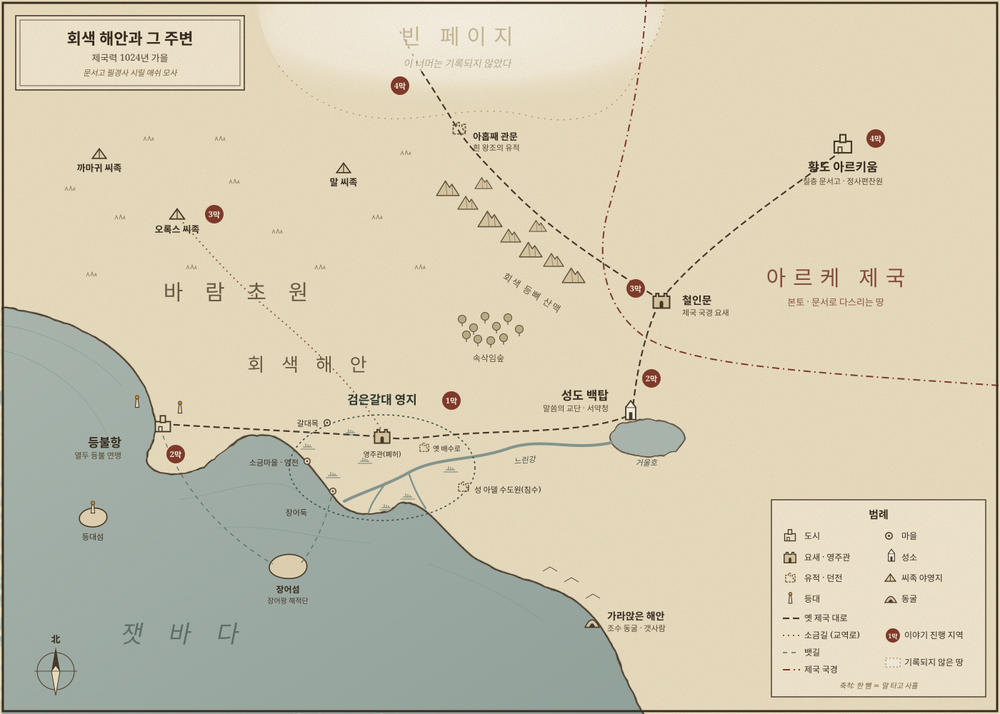

# 01. 세계와 지도

## 세계 한눈에 보기

- **시대:** 제국력 1024년. 아르케 제국의 서쪽 변방.
- **큰 문제:** 북쪽에서 하얀 안개 **'블랭크'**가 조금씩 내려온다. 안개에 덮인 마을은 지도에서 지워지고, 사람들도 그 마을을 점점 잊는다.
- **알려진 대책:** 누군가 마을에 직접 가서 확인하고 기록하면, 그 마을은 안개에 잘 먹히지 않는다. 그래서 모험가 길드에는 마을을 확인하는 **'로드워크'** 의뢰가 늘 있다. 보수가 적어서 주로 E랭크가 맡는다.

## 숨겨진 진실 (플레이어는 3장에서 알게 된다)

- 제국의 국경 관리국 **테르미누스**는 안개 근처 마을을 몰래 없앤다. 주민을 '이주'시킨 뒤 마법 인장으로 마을의 기록을 지운다. 그렇게 하면 안개가 멈춘다고 믿는다.
- 실제로는 반대다. 지운 마을은 안개를 더 키운다.
- 18년 전 지워진 북쪽 해안 어촌이 **나인의 고향**이다. 그 일을 맡은 사람은 길드의 영웅인 S랭크 모험가 **베르탄**이다. 그는 마지막 순간 아기 나인을 데리고 나와 고아원에 맡겼다.
- 나인이 어릴 때부터 부르던 자장가는 고향 어부들의 **뱃노래**다. 가사에 고향으로 가는 뱃길이 들어 있다.

## 마법

| 마법 | 설명 | 약점 |
|---|---|---|
| **글리프 마법** | 잉크로 문양을 그려서 쓰는 마법. 미리 그려 둔 두루마리는 바로 쓸 수 있다 | 물에 젖으면 번져서 못 쓴다. 잉크가 비싸다 |
| **흔적 보기** (나인만 가능) | 지워진 것의 흔적을 본다. 지워진 글자, 사라진 길, 안개 괴물의 진짜 모습 | 많이 쓰면 사람들이 나인을 잘 기억하지 못하게 된다 |

## 세력

| 세력 | 설명 |
|---|---|
| **모험가 길드** | 애쉬번에 본부가 있다. 랭크는 E~S. E랭크의 이름은 길드 벽 석판에 분필로 적고, 죽으면 지운다. 그래서 E랭크를 낮춰 **'초크네임'**이라고 부른다 |
| **아르케 제국** | 서류로 다스리는 큰 제국. 수도는 아르키움 |
| **테르미누스** | 제국의 국경 관리국. 안개 근처 마을을 관리한다 |
| **솔트마우스 뱃사람들** | 항구 도시의 어부와 선원. 길드보다 선장의 말을 믿는다 |

## 지역 7곳

| 지역 | 랭크 | 어떤 곳 | 하는 일 | 전투 특징 |
|---|---|---|---|---|
| **애쉬번** | E | 숯가마가 많은 도시. 길드 본부와 나인이 자란 고아원이 있다 | 의뢰 받기, 장비 정비, 휴식 | 좁은 골목, 연기 |
| **수트우드 숲** | E | 숯 굽는 마을 '콜리어스 엔드'가 있는 숲 | 첫 사냥, 첫 사건 | 연기 때문에 시야가 좁다. 불을 쓰면 숯가마가 터진다 |
| **솔트마우스** | D | 강 하구의 항구 도시. 서쪽은 '에코 해' 바다 | 호위, 바다 의뢰, 선장 울라와의 만남 | 배 위에서는 흔들린다. 물에 빠지면 갑옷 때문에 가라앉는다 |
| **블랙샤프트 광산** | D | 산속 광산. 아래층에 고대 유적이 있다 | 광산 구조, 골렘 셉트 발견 | 어둡다(랜턴이 한 손을 차지). 통로가 좁다. 낙석 |
| **페일필드** | C | 안개와 가까운 평원. 색이 바랜 마을들 | 로드워크, 마을 이주 사건 | 안개 괴물. 흐릿해서 적 정체를 알아보기 어렵다 |
| **아르키움** | B | 제국 수도. 거대한 문서 보관소가 있다 | 잠입, 증거 찾기, 청문회 | 문서고 안에서는 불 금지. 경비 순찰 |
| **블랭크** | A | 북쪽 안개 속. 배를 타고 들어간다 | 고향 찾기, 마지막 결전 | 지도와 마법이 안 통한다. 자장가로 길을 찾는다 |

## 생활

- **돈:** 은화 '크라운', 동전 '페니'. E랭크 의뢰 하나의 보수는 페니 몇 개.
- **숙소:** E랭크는 길드 공동숙소를 쓴다. 침대 하나를 두 사람이 낮과 밤에 번갈아 쓴다.
- **치료:** 랭크가 낮으면 약사에게, 높으면 사제에게 치료받는다. 사제 치료는 비싸다.
- **에코 해의 풍습:** 바다 안개 속에서 이름을 외치면 메아리가 돌아온다. 뱃사람들은 실종된 동료의 이름을 안개에 외친다.
- **북해 항해 금지:** 북쪽 바다로 간 배는 돌아오지 않는다. 제국은 북쪽 항해를 금지했다.
