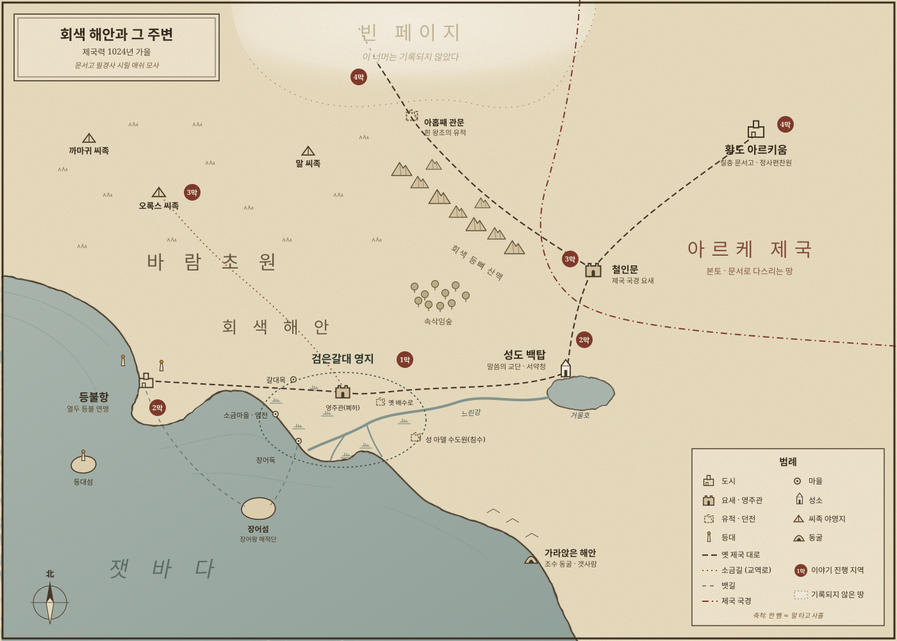

# 02. 지도와 지역

> 설계 원칙
> 1. **지명은 그 자체로 설명이 된다.** 검은갈대, 등불항, 백탑처럼 이름만 들어도 풍경이 떠오르게 한다. 원작 분석에서 약점으로 짚은 '고유명사가 몰리는 설명'을 피하기 위해서다.
> 2. **지역마다 전투 규칙이 다르다.** 같은 기술도 어디서 쓰느냐에 따라 결과가 달라진다. (원작 484화: 같은 열기의 샘이 인간에게는 피해, 어인에게는 회복)
> 3. **풍경에는 이유가 있다.** 마을이 왜 돌로 지어졌는지, 왜 비어 있는지를 산업과 역사로 설명할 수 있어야 한다. (원작 239화: 석조 마을 → 채석장 → 산업 쇠락)

## 지역 한눈에 보기

| 지역 | 해금 | 성격 | 전투 환경 핵심 |
|---|---|---|---|
| 검은갈대 영지 | 1막 | 주인공의 영지, 메인 허브 | 늪: 회피 감소, 갈대 시야 차단, 잦은 비 |
| 등불항 | 2막 | 상업 자유항, 정치·금융 | 좁은 골목과 실내, 화물 크레인, 지붕 기동 |
| 성도 백탑 | 2막 | 교단의 성지, 외교 | 침묵의 종, 성역에서 맹세 강화 |
| 바람초원 | 3막 | 씨족의 땅, 동맹과 갈등 | 바람: 사격 편차, 불을 쓰면 초원 화재 |
| 철인문과 옛 대로 | 3막 | 국경 요새, 전쟁 | 공성, 참호, 관문 |
| 황도 아르키움 | 3~4막 | 제국 수도, 칠층 문서고 | 종이투성이: 불 금지, 서인술 증폭 |
| 가라앉은 해안 | 선택 | 갯사람의 조수 동굴 | 물속: 서인술 불가, 갑옷 무게 |
| 빈 페이지 | 4막 | 기록되지 않은 땅 | 글자와 이름이 사라짐. 소거만 정상 작동 |

---

## 1. 검은갈대 영지 (1막 · 메인 허브)

**한 줄:** 3년 안에 지도에서 사라질 땅. 아무도 원하지 않아서 주인공에게 떠넘겨졌다.

- **풍경:** 사람 키를 넘는 검은 갈대, 하얗게 말라붙은 염전, 썩은 나무 둑. 비가 잦고 안개가 늦게 걷힌다.
- **주요 장소**
  - **영주관(폐허):** 전 영주 셋이 차례로 도망치거나 죽었다. 지붕 절반이 없다. 영지 경영의 거점이며, 복구 단계에 따라 모습이 바뀐다.
  - **갈대목:** 갈대를 베어 종이 원료를 만드는 마을. 영지에서 가장 가난하고, 가장 먼저 주인공을 믿어 준다.
  - **소금마을과 염전:** 영지의 돈줄. 염전 감독 베사 할멈이 실질적인 영주다.
  - **장어둑:** 어부 마을. 해적에게 상납하는 대신 약탈을 피해 왔다. 해적과 혈연으로 얽힌 집이 많다.
  - **옛 배수로:** 흰 왕조가 만든 지하 배수 시설. 지금은 던전이다. 1막 역병의 진원지.
  - **성 아델 수도원(침수):** 절반이 물에 잠긴 수도원. 이졸데가 재건하러 온다.
- **생활:** 갈대를 베는 계절, 소금을 굽는 계절, 장어가 올라오는 계절에 따라 마을 사람들의 일과와 의뢰가 바뀐다. 장례를 치르려면 사망 증명서가 필요한데 서기가 없어서, 주인공이 오기 전까지 무연고 시신이 수도원 지하에 쌓여 있었다.
- **전투 환경**
  - 무릎 깊이 물: 회피 거리 감소, 넘어지면 갑옷이 무거울수록 일어나는 데 오래 걸림.
  - 갈대밭: 시야 차단. 소리로만 위치 파악. 불을 붙이면 순식간에 번지지만 영지 산업이 타 버린다.
  - 소금 결정 지대: 상처 입은 적은 출혈 상태가 악화된다. 아군도 마찬가지다.
  - 잦은 비: 서인술 두루마리가 번진다. 방수 통을 챙기는 것이 준비의 일부다.

## 2. 등불항 (2막)

**한 줄:** 맹세보다 장부를 믿는 도시.

- **풍경:** 열두 개의 등대가 열두 가지 색으로 빛난다. 등대 불빛의 색이 곧 가문의 문장이다.
- **주요 장소:** 열두 등불 의사당, 환어음 거래소 '등표장', 해상보험 조합, 결투 재판장, 부두 빈민가 '젖은 골목'.
- **생활:** 봉쇄가 걸리면 등표 가치가 떨어져 여관이 은화만 받는다. 은화가 없는 외지인은 노숙자가 되고, 노숙자는 부두의 일용직이 된다. 결투 재판이 합법이라 빚진 기사들이 대리 결투사로 일한다.
- **전투 환경**
  - 좁은 골목과 실내: 장병기가 벽과 천장에 걸린다. 짧은 무기가 유리하다.
  - 화물 크레인과 밧줄: 밧줄을 끊어 화물을 떨어뜨리는 환경 공격이 가능하다. 적도 쓴다.
  - 지붕: 지붕을 타는 기동로가 있다. 핀이 길을 안다.
  - 부두: 물에 빠지면 갑옷을 벗을지 말지 선택해야 한다. 벗으면 산다. 대신 장비를 잃는다.

## 3. 성도 백탑과 거울호 (2막)

**한 줄:** 말한 것이 지켜지는 도시. 그래서 아무도 쉽게 말하지 않는다.

- **풍경:** 흰 돌로 쌓은 탑들이 호수에 비친다. 사람들은 말을 아끼고 손짓으로 흥정한다.
- **주요 장소:** 대성전, 서약청, 낙인의 광장, 순례자 숙소 거리, 호숫가 병자촌.
- **생활:** 하루 세 번 침묵의 종이 울리는 동안 시장이 멈춘다. 서약청 앞에는 계약하러 온 상인들이 줄을 서고, 서약 대행 사제가 수수료를 받는다. 혀에 낙인이 찍힌 사람은 증인이 될 수 없어서 법정 밖에서만 산다.
- **전투 환경**
  - 침묵의 종: 울리는 동안 영창이 필요한 기술과 맹세 기술을 쓸 수 없다. 적 지휘관의 명령도 막힌다.
  - 성역: 맹세 효과가 두 배. 대신 이곳에서 맹세를 깨면 벌도 두 배.
  - 거짓말: 성역 안에서 거짓말을 하면 혀가 굳는다. 주인공만 예외다.

## 4. 바람초원 (3막)

**한 줄:** 종이에 적힌 것을 믿지 않는 사람들의 땅.

- **풍경:** 끝없는 풀, 낮게 깔린 구름, 돌무더기 이정표. 이정표마다 씨족의 노래 한 소절이 대응된다.
- **주요 장소:** 오록스 씨족 겨울 야영지, 까마귀 씨족의 하늘장(조장) 언덕, 말 씨족 교역장, 불탄 제국 정착촌 세 곳, 아홉째 관문(흰 왕조 유적).
- **생활:** 씨족의 땅 경계는 문서가 아니라 노래로 기억된다. 땅 분쟁이 나면 양쪽 기억지기가 노래로 대결한다. 소금은 화폐처럼 쓰인다.
- **전투 환경**
  - 바람: 원거리 사격에 편차가 생긴다. 바람을 읽는 동료가 있으면 보정된다.
  - 불: 초원에서 불을 쓰면 화재가 번져 아군도 위험하고 씨족 평판이 폭락한다.
  - 기병: 탁 트인 지형이라 기병 돌격이 강하다. 돌무더기와 언덕 뒤가 유일한 엄폐물이다.

## 5. 철인문과 옛 제국 대로 (3막)

**한 줄:** 제국이 해안을 들여다보는 문.

- **풍경:** 흰 왕조가 깐 돌길 위에 제국이 쌓은 철문. 길은 600년이 지나도 멀쩡한데, 요새는 30년 만에 금이 갔다.
- **주요 장소:** 철인문 요새, 대로변 역참, 버려진 관문 초소들, 평정군 주둔지.
- **생활:** 통행증 검문 때문에 상인 행렬이 사흘씩 묶인다. 검문소 주변에 노점과 숙박촌이 생겼다. 통행증 위조가 이곳의 주요 범죄다.
- **전투 환경:** 공성전과 방어전. 참호, 목책, 관문, 투석기. 주둔지 운영에서는 사제의 소진, 서인사의 경보 유지, 비에 대비한 작업이 모두 전력이 된다. ([06 §6](06-systems.md#6-영지와-군-운영))

## 6. 황도 아르키움 (3~4막)

**한 줄:** 세계에서 종이가 가장 많은 도시.

- **풍경:** 일곱 층으로 쌓은 문서고가 도시 한가운데 솟아 있다. 거리마다 필경사와 서기가 줄지어 앉아 있다.
- **주요 장소:** 칠층 문서고, 정사편찬원, 대인장 보관소, 필경사 거리, 표류물 창고(프롤로그의 무대).
- **생활:** 모든 시민이 신분 문서를 몸에 지니고 다닌다. 문서를 잃으면 존재를 증명할 수 없어 노숙자가 된다. 도시 전체가 화재를 두려워해 밤에 등불 수를 세는 순찰이 돈다.
- **전투 환경**
  - 불 금지: 불을 쓰면 즉시 경보. 문서고 안에서는 불 계열 기술이 봉인된다.
  - 서인술 증폭: 사방이 매체라 서인술이 강해진다. 적 서인사도 마찬가지다.
  - 경비 체계: 문서고 경비는 층마다 다르다. 잠입 루트를 설계하는 재미가 핵심이다.

## 7. 가라앉은 해안과 조수 동굴 (선택 지역)

**한 줄:** 하루에 두 번 땅이 되고 두 번 바다가 되는 곳.

- **풍경:** 썰물 때만 드러나는 옛 마을의 지붕들. 갯사람은 그 지붕 아래에 산다.
- **주요 장소:** 조수 동굴, 가라앉은 종탑, 갯사람의 진주 시장.
- **생활:** 시간이 물때로 계산된다. 갯사람과의 거래는 썰물 동안에만 가능하다.
- **전투 환경**
  - 물때: 밀물이 들면 전장이 바뀐다. 썰물 때 들어갔다가 밀물에 갇힐 수 있다.
  - 물속: 서인술 불가, 화약 불가. 갑옷이 무거우면 가라앉는다. 갯사람은 물속에서 회복한다.
- **역할:** 4막 빈 페이지에 들어갈 때 필요한 '물에 지워지지 않는 잉크'(갯사람의 진주 먹)를 얻는 곳. 선택 지역이지만 엔딩 분기에 영향을 준다.

## 8. 빈 페이지 (4막)

**한 줄:** 지도가 그려지지 않는 땅. 지워진 것들이 고이는 곳.

- **풍경:** 색이 빠진 세계. 나무는 윤곽선만 남고, 길은 중간에서 끊긴다. 가끔 다른 시간의 물건이 놓여 있다.
- **주요 장소:** 흰 왕조의 마지막 문서고, 지워진 마을들(핀의 고향 포함), 균열의 중심.
- **전투 환경과 연출**
  - 서인술 불가, 서약 무효(신이 듣지 못한다).
  - **화면 UI가 지워진다.** 미니맵, 퀘스트 표시, NPC 이름표가 점점 사라진다. 동료의 이름도 '???'로 바뀐다. 동료와의 관계가 깊을수록 이름이 오래 남는다.
  - 주인공의 소거만 정상 작동한다. 주인공에게는 가장 강해지는 장소이자, 가장 많이 흐려지는 장소다.
  - 적 '백지귀': 지워진 존재의 잔해. 닿은 것의 정보를 지운다. 맞으면 장비 이름, 스킬 설명이 잠시 빈칸이 된다.

---

## 이동과 지역 연결

- **옛 제국 대로:** 등불항 → 검은갈대 → 백탑 → 철인문 → 황도. 가장 빠르지만 검문이 있다.
- **소금길:** 검은갈대 → 오록스 씨족. 영지 소금 교역로. 교역이 끊기면 씨족 관계가 나빠진다.
- **뱃길:** 등불항 ↔ 장어섬 ↔ 장어둑. 해적과의 관계에 따라 안전도가 바뀐다.
- **빠른 이동:** 처음에는 없다. 역참을 복구하거나 통행증을 얻으면 해금된다. 이동 자체가 시간과 비용이라는 감각을 초반에 심어 두기 위해서다.
