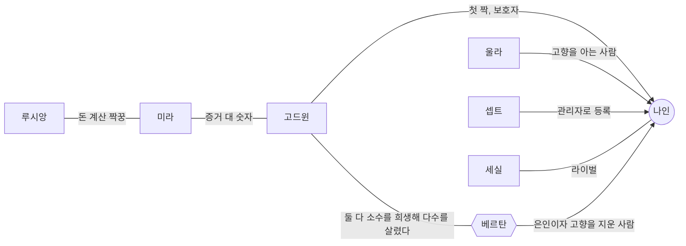

# 03. 등장인물

## 인물을 만들 때 지킬 것

원작에서 인물이 살아 있다고 느낀 이유를 정리한 규칙입니다.

1. **판단 기준이 하나씩 있다.** 같은 상황에서도 사람마다 다르게 판단한다.
2. **첫인상과 실제가 다르다.** 겉보기와 진짜 특기가 다르다.
3. **습관이나 물건이 있다.** 한 번 보면 기억나는 버릇이나 소지품이 있다.
4. **비밀이 하나 있다.** 친해지면 알게 된다.
5. **친해진 것을 말이 아니라 행동으로 보여 준다.** 물건을 건네거나 위험을 대신 진다.

---

## 주인공: 나인

| 항목 | 내용 |
|---|---|
| 나이 | 18세 |
| 출신 | 램프라이트 고아원의 아홉 번째 아이. 그래서 이름이 '나인' |
| 성격 | 밝고 넉살이 좋다. 부탁을 거절하지 못한다 |
| 습관 | 처음 만난 사람의 이름을 세 번 되뇐다. 긴장하면 자장가를 흥얼거린다 |
| 소지품 | 베르탄에게 받은 낡은 단검, 고아원 열쇠 |
| 잘하는 것 | 사람 얼굴과 이름을 절대 안 잊는다. 고아원에서 해 본 잡일은 뭐든 잘한다 |
| 약점 | 전투는 평범하다. 버려질까 봐 무리한 의뢰를 받는다 |
| 능력 | 흔적 보기 (지워진 것을 본다. 많이 쓰면 사람들이 나인을 잊는다) |
| 성장 | 남에게 잊히지 않으려고 애쓰던 아이가, 자기 이름을 스스로 정하는 사람이 된다 |

> "괜찮아요. 저는 원래 잘 잊혀요. 그러니까 제가 먼저 기억할게요."

---

## 동료 5명

| 이름 | 나이 | 역할 | 판단 기준 | 합류 |
|---|---|---|---|---|
| 고드윈 | 51 | 방패 (탱커) | 더 많은 사람을 살리는 쪽 | 1장 |
| 미라 | 34 | 약사 (치료·독) | 증거가 있는가 | 1장 |
| 루시앙 | 29 | 사기꾼 (자물쇠·교란) | 공정한 거래인가 | 1장 |
| 울라 | 62 | 선장 (작살·밧줄) | 약속을 지키는가 | 2장 |
| 셉트 | ? | 고대 골렘 (탱커) | 규칙에 맞는가 | 2장 |

### 고드윈 레이크

- **누구:** 군 출신 하사관. 군 경력을 인정받지 못해 51세에 E랭크로 시작한 늦깎이 신참. 나인의 첫 짝.
- **성격:** 무뚝뚝하고 말이 아주 짧다.
- **습관:** 매일 밤 수첩에 무언가를 적는다. 술을 9년째 끊었다.
- **첫인상 vs 실제:** 고집 센 노인 → 야영, 보급, 부대 관리의 달인.
- **비밀:** 군 시절 전염병이 돈 포로수용소에서, 보급이 끊기자 포로 백 명을 처형했다. 수첩 첫 장에 그 백 명의 이름이 적혀 있다.
- **대사:** "적 열둘. 우리 넷. 물러납시다."

### 미라 쇼른

- **누구:** 면허 없는 약사. 시신을 수습하는 의뢰만 골라 받는다.
- **성격:** 밝고 수다스럽다. 무서운 말을 아무렇지 않게 한다.
- **습관:** 사람을 보면 손톱 색과 눈을 먼저 본다.
- **첫인상 vs 실제:** 이상한 사람 → 최고의 의사. 처음 보는 적의 약점을 빨리 알아낸다.
- **비밀:** 어릴 때 마을이 전염병으로 몰살됐다. 아무도 원인을 몰랐다. 그래서 시신을 연구한다.
- **대사:** "좋은 소식! 독은 아니에요. 나쁜 소식! 병도 아니에요."

### 루시앙 페어

- **누구:** B랭크라고 속였다가 들켜서 E랭크로 강등된 사기꾼.
- **성격:** 허풍이 세고 겁이 많다. 말을 잘한다.
- **습관:** 손가락으로 동전을 굴린다. **거짓말할 때는 동전이 멈춘다.**
- **첫인상 vs 실제:** 허풍쟁이 → 꼼꼼한 회계사. 위조 서류를 한눈에 알아본다.
- **비밀:** E랭크로 죽은 동생의 기록을 찾으려고 랭크를 속였다. B랭크만 볼 수 있는 기록이 있었기 때문이다.
- **대사:** "저는 거짓말 안 해요. 진실을 할인해서 팔 뿐이죠."

### 울라

- **누구:** 솔트마우스의 늙은 선장.
- **성격:** 호탕하고 반말을 한다. 술을 좋아한다.
- **습관:** 처음 배에 탄 사람에게 물을 한 바가지 퍼내게 한다. 같이 배를 지킨 사람만 손님으로 대한다.
- **첫인상 vs 실제:** 술꾼 할머니 → 북쪽 바닷길을 아는 마지막 선장.
- **비밀:** 젊을 때 나인의 고향 어촌과 거래했었다. 그런데 그 마을 이름이 기억나지 않아서 괴로워한다.
- **대사:** "종이에 쓴 약속은 종이가 지키고, 입으로 한 약속은 사람이 지키는 거다."

### 셉트

- **누구:** 블랙샤프트 광산 아래 유적에서 깨어난 고대 골렘.
- **성격:** 융통성이 전혀 없다. 처음에는 규칙 문장으로만 말하다가, 친해질수록 자기 말을 하기 시작한다.
- **습관:** 모든 것에 번호를 붙인다. 비가 오면 멈춘다(몸의 문양이 번질까 봐).
- **첫인상 vs 실제:** 위험한 고대 병기 → 옛 왕조의 기록을 기억하는 보관 장치.
- **비밀:** 옛 왕조가 마을을 지울 때 쓰던 도구였다.
- **대사:** (처음) "규칙 3조에 따라 귀하를 관리자로 등록함." → (나중) "규칙에는 없음. 그래도 나는 이걸 지키고 싶다."

---

## 라이벌과 적

### 세실 그레이 (라이벌)

- 귀족 집안 출신 동기. 집안 추천서로 D랭크부터 시작해서 빠르게 올라간다.
- 테르미누스의 이주 의뢰를 맡는다. 3장에서 나인 편에 설지 베르탄 편에 설지 정한다.
- 매일 아침 나인보다 먼저 게시판의 좋은 의뢰를 가져간다. 그런데 E랭크용 의뢰는 일부러 남겨 둔다.

### 베르탄 (최종 적)

- 길드에 하나뿐인 S랭크 모험가. 고아원의 후원자. 매년 겨울 과자를 들고 와서 아이들 이름을 한 명씩 불러 준다.
- 테르미누스의 마을 지우기를 맡아 온 사람. "마을 하나를 지워서 열 개를 지킨다"고 믿는다.
- 18년 전 나인의 고향을 지웠고, 아기 나인을 구해서 고아원에 맡겼다.
- 지운 마을 사람들의 이름을 하나도 잊지 못하고 매일 밤 중얼거린다.

### 주요 인물

| 이름 | 누구 |
|---|---|
| 도린 | 길드 접수원. E랭크 이름을 석판에 적고 지우는 사람. 나인의 이름이 저절로 흐려지는 것을 보고 몰래 다시 써 준다 |
| 마사 | 램프라이트 고아원 원장 |
| 핀 | 고아원 막내(9세). 나인을 영웅으로 생각한다 |
| 토마 | E랭크 동기. 나인에게 게시판 요령을 알려 준다. 1장에서 죽는다 |

---

## 같은 상황, 다른 반응

동료 반응 시스템이 실제로 어떻게 보이는지 보여 주는 예시입니다.

**상황 (3장):** 벨톨 마을 이주 호위 중. 한 노인이 마을을 떠나지 않겠다고 버틴다. 억지로 데려갈 것인가?

| 동료 | 의견 | 이유 |
|---|---|---|
| 고드윈 | 데려간다 | "한 사람 때문에 마흔 명 이주가 하루 늦어지면 다 위험해집니다." |
| 미라 | 이유부터 확인 | "이주하는 이유가 뭐예요? 홍수도 병도 없잖아요." |
| 루시앙 | 서류부터 확인 | "이주 계약서에 보상 조항이 없네요. 이건 이주가 아니라 쫓아내는 거예요." |
| 울라 | 노인에게 묻는다 | "저 노인한테 우리가 뭘 약속했지? 아무것도. 그럼 묻는 게 먼저야." |
| 셉트 | 규칙 확인 | "이주 규칙 7조: 본인 서명 필요. 서명란이 비어 있음." |

다섯 명의 이유는 다르지만, 모두 이 이주가 수상하다는 단서로 이어집니다.

---

## 관계도

