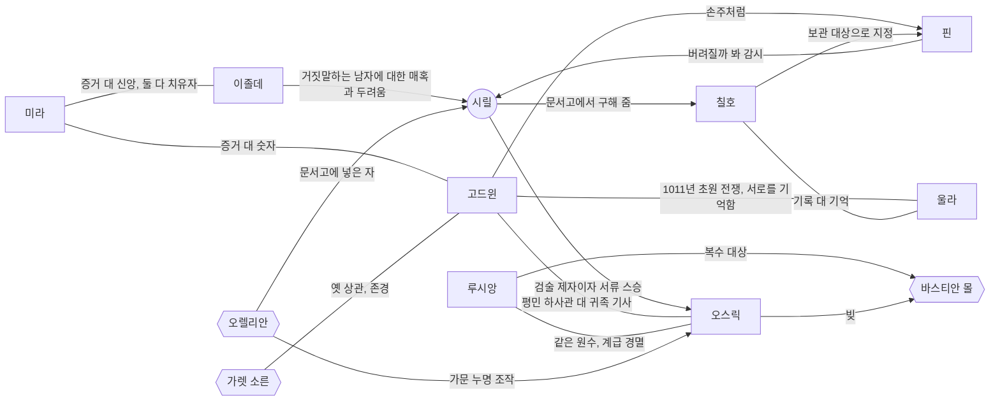

# 04. 등장인물

## 캐릭터 설계 체크리스트

원작 독해 메모에서 '인물이 살아 있게 만드는 기법'을 12가지로 추렸습니다. 모든 주요 인물은 이 목록을 채워야 합니다.

| # | 기법 | 원작 근거 | 이 기획에서 |
|---|---|---|---|
| 1 | 같은 사안에 인물마다 판단 기준이 다르다 | 246화: 같은 회유에 명예·양심·계약·가문으로 갈림 | 동료마다 **판단 기준** 하나를 명시한다 |
| 2 | 보상을 해석하는 언어가 다르다 | 186화: 임금 계약 vs 훈련·장비를 은혜로 여김 | 동료마다 **무엇을 보상으로 여기는가**를 정한다 |
| 3 | 상처가 생계로 이어진다 | 148·155화: 팔을 잃은 동료가 은퇴 계산 끝에 대관이 됨 | 동료마다 **영구 부상 시 전환 역할**을 정한다 |
| 4 | 직업명·첫인상과 실제 능력이 어긋난다 | 159화, 7화, 30화 | **이름이 주는 기대 vs 실제 특기** |
| 5 | 호의를 나중에 다시 읽게 된다 | 61~63화, 226화 | 동료마다 **숨은 얼굴** 하나 |
| 6 | 주인공을 바깥 시선으로 본다 | 86화, 103화 | 각 막의 막간과 동료의 주인공 평가 |
| 7 | 고유한 습관·금기·소품 | 88화 깃털모자, 192·214화 사탕과 차 | 동료마다 **습관 + 소품** |
| 8 | 주인공이 정할 수 없는 성장 | 105·159화, 262화 | 동료마다 **스스로 성장하는 지점** |
| 9 | 전언이 나중에 정정된다 | 75화 → 78화 | 정사의 기록 자체가 '전언'이다 |
| 10 | 악역에게도 생활과 논리가 있다 | 40화, 165화, 408화 | 적대자마다 **생활 장면** 하나 |
| 11 | 한 사람 안에 선행과 억압이 함께 있다 | 318화, 563~564화 | 적대자와 NPC 대부분 |
| 12 | 관계 변화는 말이 아니라 위험 부담과 물건으로 확정된다 | 48화, 96화, 187화 | 관계 단계가 오를 때 **선물·행동 이벤트** |

## 정사가 틀리는 방식은 동료마다 다르다

모든 동료가 '사실은 누명'이면 금방 단조로워집니다. 그래서 기록과 진실의 관계를 동료마다 다르게 설계했습니다.

| 동료 | 정사의 낙인 | 기록의 진실 |
|---|---|---|
| 미라 | 우물의 마녀 | **이전:** 원인을 찾은 사람이 원인으로 기록됐다. 다만 금기를 어긴 것은 사실이다 |
| 고드윈 | 백 명을 묻은 하사관 | **생략:** 사실이다. 맥락이 지워졌다. 본인은 맥락을 남기길 거부한다 |
| 루시앙 | 등불항을 무너뜨린 사기꾼 | **미래:** 아직 하지 않았다. 지금 준비 중이다 |
| 이졸데 | 회색 해안을 정화한 성녀 | **반전:** 유일하게 영웅으로 기록됐다. 그 '정화'가 학살이다 |
| 핀 | (기록 없음) | **말소:** 존재 자체가 지워졌다 |
| 오스릭 | 반역 기사 | **과소:** 정사가 덜 적었다. 실제 계획은 훨씬 치밀하다 |
| 칠호 | 문서고를 불태운 폭주 병기 | **사실:** 의도적으로 했다. 후회하지 않는다 |
| 울라 | 정착촌 셋을 불태운 초원의 마녀 | **숫자:** 한 곳은 사실이다. 나머지 둘은 제국군이 태웠다 |

---

## 주인공: 시릴 애쉬

> "기록에 없는 사람이 기록을 고친다. 웃기지도 않지. 근데 그게 제일 잘하는 일이라서."

- **나이·전직:** 28세. 제국 문서고 하급 필경사.
- **실루엣·소품:** 작은 체격, 잉크가 밴 손가락. 칼집 대신 허리에 찬 펜 통. 영지에서는 이 펜 통을 끝까지 버리지 않는다.
- **목소리:** 겉으로는 공손하고 속으로는 투덜댄다. 게임 내내 **겉말과 속말을 나란히** 보여 준다.

  > (겉말) "영광입니다, 각하. 성심껏 받들겠습니다."
  > (속말) 받들긴 뭘 받들어. 지붕도 없는 영지를.

- **강점:** 숫자, 문서, 규정, 위조 감별. 서류 한 장으로 사람을 살리고 죽일 수 있다는 것을 안다.
- **약점:** 칼이 서툴다(오스릭에게 배운다). 사람을 '기록'으로 미리 재단한다. 미래를 안다는 오만이 있다.
- **능력:** 소거. 상처가 잉크처럼 지워진다. 대신 통증은 미뤄질 뿐이고, 쓸수록 세상이 그를 기억하기 어려워한다.
- **성장 축:** 기록으로 사람을 보던 사람에서, 사람을 보고 기록을 쓰는 사람으로.
- **바깥 시선:** 동료에게는 투덜이. 주민에게는 피투성이로 웃는 무서운 영주. 적에게는 피를 흘리지 않는 괴물.
- **유혹:** 세계에서 유일하게 맹세를 어길 수 있는 사람. 이 힘을 얼마나 쓰느냐가 엔딩의 결을 바꾼다.

---

## 동료 8인

### 1. 미라 쇼른 — "우물의 마녀"

> 정사: "검은갈대의 마녀 미라 쇼른이 우물에 독을 풀어 사백 명이 죽었다."

- **기본:** 34세, 검은갈대 마을 약제사. 1막 합류.
- **실루엣·소품:** 주머니가 열두 개 달린 앞치마, 늘 걷어 올린 소매, 목에 건 확대 렌즈.
- **습관:** 사람을 보면 무심코 손톱 색과 눈 흰자를 본다. 기분이 좋으면 콧노래를 부르는데, 곡이 장송곡이다.
- **말투:** 밝고 빠르다. 끔찍한 말을 아침 인사처럼 한다.
  > "좋은 소식! 이건 역병이 아니에요. 나쁜 소식! 독도 아니에요."
  > "울지 마세요. 우는 건 나중에 해도 되는데, 이 시신은 내일이면 늦어요."
- **판단 기준:** 증거. 확인되지 않은 것은 말하지 않는다.
- **보상으로 여기는 것:** 돈이 아니라 **무연고 시신의 해부 허가서.** 알 권리.
- **이름이 주는 기대 vs 실제:** '마녀'지만 마법은 거의 못 쓴다(무면허 서인 몇 개뿐). 실제 특기는 **진단**이다. 처음 보는 적의 정체를 빠르게 확정한다. ([06 §2 인지 시스템](06-systems.md#2-인지-시스템-알아보는-순서))
- **전투:** 투척 약병, 연막, 해독, 적 약점 진단. **영지:** 진료소, 위생, 역병 대응.
- **결점:** 죽음에 무디다. 유족 앞에서 말실수를 한다. 교단 금기를 가볍게 여겨 교단 평판을 깎는다. 쓰러질 때까지 일한다.
- **숨은 얼굴:** 쾌활함은 방어다. 어릴 때 역병으로 마을이 몰살됐을 때 아무도 원인을 몰랐다. 그래서 시신을 연다.
- **영구 부상 시:** 실험 중 양손에 화상 → 정밀 작업 불가 → 영지 의학교의 교관이 된다.
- **정사를 보여 주면:** 웃는다. "사백 명? 내가 그렇게 일을 잘했다고요?" 그리고 그날 밤 혼자 우물을 다시 조사한다.
- **스스로 성장:** 이졸데와의 관계가 깊어지면, 교단 의술과 자기 의술을 섞은 새 치료법을 혼자 만들어 온다.

### 2. 고드윈 레이크 — "백 명을 묻은 하사관"

> 정사: "탈영병 고드윈 레이크는 투항한 포로 백 명을 처형하였다."

- **기본:** 51세, 전 제국군 하사관. 죄수 수비대장. 프롤로그 합류.
- **실루엣·소품:** 문짝만 한 방패, 한쪽 무릎에만 찬 보호대, 짧게 깎은 회색 수염. 매일 밤 무언가를 적는 낡은 장부.
- **습관:** 9년째 술을 끊었다. 술잔을 받으면 냄새만 맡고 내려놓는다.
- **말투:** 보고체. 극단적으로 짧다.
  > "적 열둘. 아군 넷. 후퇴 권고."
  > "살린 사람은 장부 왼쪽에 적습니다. 오른쪽은 묻지 마십시오."
- **판단 기준:** 숫자. 더 많이 살리는 쪽.
- **보상으로 여기는 것:** 임금이 아니라 **맡겨진 부하.** 병사를 맡기는 것이 그에게 최고의 신뢰 표시다.
- **이름이 주는 기대 vs 실제:** '학살자'지만 최고의 특기는 칼이 아니라 **병참, 위생, 참호.** 전투보다 군대를 굴리는 일.
- **전투:** 대방패 전열, 진형 강화, 도발. **영지:** 민병 훈련, 병참, 축성.
- **결점:** 숫자로 사람을 본다. 소수를 쉽게 포기한다. 명령 계통에 집착한다.
- **진실:** 기록은 사실이다. 역병이 도는 포로 수용소에서 보급이 끊겼고 장교는 도망쳤다. 포로를 풀면 역병이 부대로 번지고, 데려가면 부대가 굶는다. 그는 백 명을 죽이고 천 명을 살렸다. 그리고 자수했다. 상부는 사건을 덮으려고 그를 '탈영병'으로 처리했다.
- **숨은 얼굴:** 장부의 첫 장에는 처형한 백 명의 이름이 적혀 있다. 전부 외운다.
- **영구 부상 시:** 무릎이 완전히 망가지면 → 영지 민병 교관 겸 병참관.
- **정사를 보여 주면:** "맞는 기록입니다." 끝이다. 주인공이 맥락을 다시 기록해 주겠다고 하면 처음으로 화를 낸다. "변명을 남기지 마십시오."
- **스스로 성장:** 숫자의 논리를 버리게 만들 수는 없다. 2막과 3막에서 '소수를 구했더니 다수도 살았던' 경험이 쌓이면 스스로 장부 쓰는 법을 바꾼다.

### 3. 루시앙 페어 — "등불항을 무너뜨린 사기꾼"

> 정사: "사기꾼 루시앙 페어의 위조 환어음이 열두 등불 연맹을 무너뜨렸다."

- **기본:** 29세, 위조범. 호송 마차의 죄수. 프롤로그 합류.
- **실루엣·소품:** 한때 고급이었던 깃 높은 외투, 잉크 묻은 손가락, 손가락 사이로 굴리는 동전 하나.
- **습관:** 모든 것을 값으로 환산한다. **거짓말을 할 때 동전 굴리기를 멈춘다.** 눈치 빠른 플레이어만 알아챌 수 있는 단서다.
- **말투:** 수다, 비유, 숫자, 허세.
  > "영주님, 이 영지는 빚더미가 아닙니다. 저평가된 자산이죠."
  > "저는 거짓말을 안 합니다. 진실을 할인해서 팔 뿐이에요."
- **판단 기준:** 거래의 공정함. 받은 만큼 돌려준다. 은혜도, 원한도.
- **보상으로 여기는 것:** 돈이 아니라 **신용.** 돈은 '만들 수' 있지만 믿음은 못 만든다.
- **이름이 주는 기대 vs 실제:** '사기꾼'이지만 실제 특기는 **정직한 회계와 위조 감별.** 영지 장부를 맡기면 최고다.
- **전투:** 겁쟁이다. 대신 교란(가짜 명령 외치기, 위조 신호기), 도발. 대화 전투의 핵심 동료. **영지:** 재정, 교역, 환어음.
- **결점:** 겁, 허세, 복수 집착. 가끔 영지 돈을 몰래 '굴린다.'
- **숨은 얼굴:** 그의 친절은 처음에 계산이었다. 영지를 복수의 발판으로 쓰려고 했다. 2막에서 드러난다.
- **영구 부상 시:** 손가락을 다치면 위조가 불가능해진다. 정직하게 살 수밖에 없다. 본인은 이걸 가장 큰 불행이라고 투덜댄다.
- **정사를 보여 주면:** 처음으로 동전을 떨어뜨린다. "제가… 성공한다고요?" 기뻐하다가, 대폭락 이후 목숨을 끊은 서민들의 명단을 보고 말을 잃는다.
- **스스로 성장:** 복수를 멈추게 '설득'할 수는 없다. 대폭락 직전, 그는 영지에서 쌓은 신용과 복수 중 하나를 스스로 고른다. 플레이어는 그 순간까지 무엇을 보여 줬는지로만 영향을 준다.

### 4. 이졸데 벨린 — "회색 해안을 정화한 성녀"

> 정사: "성녀 이졸데의 빛이 회색 해안을 정화하였다."

- **기본:** 22세, 말씀의 교단 사제. 수도원 재건을 위해 파견됨. 1막 후반 합류.
- **실루엣·소품:** 진흙 묻은 흰 사제복, 맨발(신발을 신지 않는 순례 서약), 손목의 서약 매듭.
- **습관:** 매일 아침 맨발로 걷는다. 발이 늘 상처투성이다. 모르는 것을 부끄러워하지 않고 질문한다.
- **말투:** 정중한 경어와 경전 인용. 그리고 엉뚱하게 날카로운 질문.
  > "영주님은 거짓말을 하실 때 혀가 아프지 않으세요?" (2막 복선)
  > "고통이 시험이라면, 저는 이 마을 사람들이 너무 많이 시험받았다고 생각해요."
- **판단 기준:** 교리. 하지만 교리와 눈앞의 사람이 부딪히면 흔들린다. **그 흔들림의 방향이 성녀 루트를 결정한다.**
- **보상으로 여기는 것:** 고해. 남의 짐을 대신 지는 것. 고맙다는 말보다 속을 털어놓아 주는 것을 기뻐한다.
- **이름이 주는 기대 vs 실제:** 순진한 신참 사제처럼 보이지만 교단에서 가장 강한 기적의 그릇이다. 실제 특기는 치유보다 **서약 판정**, 즉 거짓말 꿰뚫어보기다. 주인공만 빼고.
- **전투:** 치유, 맹세 강화, (후반) 정화의 불. **영지:** 수도원, 의료, 교단 관계.
- **결점:** 고통을 신의 시험으로 받아들인다. 자기 고통도, 남의 고통도. 이것이 '정화의 불'로 이어지는 씨앗이다.
- **숨은 얼굴:** 그녀의 순수함이 위험하다. 그녀는 착하기 때문에 마을을 불태울 수 있다.
- **영구 부상 시:** 기적을 과다하게 쓰면 시력을 잃는다. '눈먼 성녀' 루트.
- **정사를 보여 주면:** 시기에 따라 정반대다. 1막에 보여 주면 신앙 위기가 와서 교단을 떠날 수도 있다. 3막에 보여 주면 "그렇다면 이것이 신의 뜻이군요"라며 오히려 정화를 확신할 수도 있다.
- **스스로 성장:** 플레이어는 그녀를 설득할 수 없다. **무엇을 보여 줄지만 고를 수 있다.** 그녀는 본 것으로 스스로 결정한다.

### 5. 핀 — "이름 없는 아이"

> 정사: (기록 없음)

- **기본:** 겉보기 12세. 갈대밭에서 발견된 기억 잃은 아이. 1막 합류.
- **실루엣·소품:** 몸에 안 맞는 남자 외투, 늘 불룩한 주머니(빵).
- **습관:** 먹을 것을 곳곳에 숨긴다. 잘 때 문 쪽을 보고 잔다. 아무도 가르치지 않았는데 글을, 그것도 옛 문자를 읽는다.
- **말투:** 반말, 은어, 짧고 퉁명하다.
  > "아저씨가 영주야? 영주는 원래 더 뚱뚱하던데."
  > "버릴 거면 지금 버려. 나중에 버리면 귀찮으니까."
- **판단 기준:** 생존. 그리고 '나를 버리는가.'
- **보상으로 여기는 것:** 먹을 것. 그리고 **이름.** '핀'은 스스로 지은 이름이다.
- **이름이 주는 기대 vs 실제:** 소매치기지만 실제 특기는 **길 찾기와 옛 문자 해독.** 빈 페이지에서도 길을 잃지 않는다.
- **전투:** 직접 싸움에는 나서지 않는다. 시릴이 아이를 전투에 세우지 않기 때문이다. 정찰, 자물쇠, 함정 해제, 지붕 기동을 맡는다. 이 선은 플레이어 선택이 아니라 주인공의 캐릭터로 고정한다.
- **결점:** 어른을 믿지 않고 거짓말을 잘한다. 겁이 나면 말없이 사라진다.
- **숨은 얼굴:** 나이를 먹지 않는다. 1막부터 4막까지 키가 그대로라는 것을 처음 알아채는 사람은 미라다.
- **몸의 대가:** 빈 페이지에 가까워질수록 몸이 흐려진다.
- **정사를 보여 주면:** 이미 몰래 읽었다. 자기가 없다는 걸 확인하고 오히려 안심했다. "나 안 죽네. 아예 없으니까."
- **스스로 성장:** 4막에서 지워진 고향의 이름을 되찾을지, 지금의 이름 '핀'으로 살지를 스스로 고른다.

### 6. 오스릭 발레타 — "반역 기사"

> 정사: "반역 기사 오스릭 발레타가 폭도를 이끌고 철인문을 공격하였다."

- **기본:** 26세, 몰락한 발레타 공작가의 적자. 등불항의 빚쟁이 대리 결투사. 2막 합류.
- **실루엣·소품:** 기운 자국투성이인 최고급 갑옷. 가문 문장을 일부러 가리지 않는다. 장검.
- **습관:** 남의 자세를 교정한다. 빚 장부를 숨긴다. 계산을 못 한다.
- **말투:** 격식체, 귀족적 비꼼.
  > "그 자세로 칼을 쥐면, 칼이 당신을 쥐게 되오."
  > "평민 하사관에게 지휘를 받으라니. 좋소. 단, 그가 틀리면 내가 말하겠소."
- **판단 기준:** 정통성과 가문. 그리고 기사의 형식(결투, 맹세, 예법).
- **보상으로 여기는 것:** 인정. 가문의 이름을 불러 주는 것. 영지 기사 서임.
- **이름이 주는 기대 vs 실제:** '반역자'지만 실제로는 **최고의 교사.** 검술 대련 시스템의 스승이다. 의외로 아이들이 따른다.
- **전투:** 1대1 결투 최강의 장검. 하지만 집단전에서는 형식에 묶인다(등 뒤를 치지 않는다). **영지:** 기사단 창설, 귀족 외교.
- **결점:** 오만, 계급 의식(고드윈을 무시함), 경제 무능, 형식 집착.
- **진실:** 정사가 오히려 덜 적었다. 그는 실제로 반란을 꾸미고 있고, 계획은 정사보다 치밀하다. 다만 발레타 가문의 반역 누명은 오렐리안의 기록 조작이었다.
- **숨은 얼굴:** 그는 시릴을 이용하려고 접근했다. 기록에 없는 자는 반란이 실패했을 때 책임을 씌우기 좋다.
- **영구 부상 시:** 검을 쥐는 손을 다치면 반대 손 검술을 처음부터 다시 배운다. 또는 칼을 놓고 지휘관이 된다. 어느 쪽인지는 그가 고른다.
- **정사를 보여 주면:** "반란은 성공하오?" 실패한다는 걸 알면 계획을 바꾼다. **정사를 보여 주면 그는 더 위험해진다.**

### 7. 칠호 — "문서고를 불태운 폭주 병기"

> 정사: "제7서고 관리 병기가 폭주하여 문서고를 불태웠다. 이를 폐기 처분하였다."

- **기본:** 약 600년 된 문서고 관리 골렘. 폐기 직전 시릴이 '영지 비품'으로 등록해 살렸다. 프롤로그 합류.
- **실루엣·소품:** 사람 두 배 크기, 온몸에 빽빽한 문양, 등에 붙은 서가.
- **습관:** 모든 것을 분류한다. 사람에게도 분류 번호를 붙인다. 비가 오면 멈춘다(문양이 번질까 봐).
- **말투:** 처음에는 **문서 인용으로만** 말한다. 인연이 깊어질수록 자기 말을 한 문장씩 섞는다. **성장이 대사로 측정되는 캐릭터.**
  > (초반) "제국 행정령 제3조에 의거, 본 개체는 귀하를 '관리자'로 등록함."
  > (후반) "규정에는 없음. 그러나, 나는 이것을 보관하고 싶다."
- **판단 기준:** 규정. 규정끼리 충돌하면 '보존'이 우선이다.
- **보상으로 여기는 것:** 무언가를 **맡기는 것.** 물건이든 기억이든.
- **이름이 주는 기대 vs 실제:** '폭주 병기'지만 실제로는 **기억 장치.** 600년 동안 본 것을 기억한다. 지워진 기록까지. 빈 페이지의 열쇠다.
- **전투:** 탱커. 느리다. 비와 불에 약하다. **영지:** 기록 보관소, 문서 정리, 측량.
- **결점:** 융통성이 전혀 없다. 말을 글자 그대로 받아들여 사고를 친다.
- **진실:** 기록은 사실이다. 그는 의도적으로 문서고를 불태웠다. 후회하지 않는다.
- **숨은 얼굴:** 600년 전 흰 왕조의 첫 대말살을 집행한 도구였다. 그가 태운 것은 말살 명령서였다.
- **영구 부상 시:** 문양이 손상되면 기억 일부를 영구히 잃는다. 고칠 수 있는 사람은 필경사인 시릴뿐이다.
- **정사를 보여 주면:** "기록 확인. 정정 요청: '폭주'를 '선택'으로." 처음으로 인용이 아닌 자기 말을 한다.

### 8. 울라 아홉노래 — "초원의 마녀"

> 정사: "초원의 마녀 울라가 제국 정착촌 세 곳을 불태웠다."

- **기본:** 57세, 오록스 씨족의 기억지기(노래로 역사를 기억하는 사람). 3막 합류.
- **실루엣·소품:** 거대한 체구, 털가죽 망토, 목에 건 매듭 끈 수십 개. 매듭 하나가 노래 하나다.
- **습관:** 문자를 경멸한다. "종이는 거짓말을 오래 보관하는 물건이다." 동료들을 손주 취급하며 놀린다.
- **말투:** 호탕한 반말, 속담, 노래 구절.
  > "글로 적은 약속은 종이가 지키지. 말로 한 약속은 사람이 지키고."
  > "꼬마 영주야, 네 노래는 아직 한 소절도 안 되는구나."
- **판단 기준:** 환대법과 말로 한 약속.
- **보상으로 여기는 것:** 이야기. 그녀는 남에게 노래를 지어 주는 것으로 존경을 표하고, 이야기를 들려주는 것으로 보답받는다.
- **이름이 주는 기대 vs 실제:** '마녀'이자 전사로 보이지만 실제 특기는 **기억과 증언.** 땅 분쟁 판정, 족보, 협상. 짐승혼 변신은 나이 때문에 하루 한 번뿐이다.
- **전투:** 하루 한 번 오록스 변신 돌격. 평소에는 지팡이와 노래로 아군 사기를 올린다. **영지:** 씨족 외교, 소금 교역.
- **결점:** 고집. 문서를 무시해서 행정 마찰을 일으킨다. 원한을 잊지 않는다.
- **진실:** 한 곳은 사실이다. 사흘 동안 떠나라고 노래한 뒤 불태웠다. 그 한 곳에 대해서는 사과하지 않는다. 나머지 두 곳은 제국군이 태우고 씨족 탓으로 돌렸다. 그 사흘 동안 정착민을 모두 대피시킨 수비대 하사가 젊은 고드윈이었다. 둘은 서로의 얼굴을 기억한다.
- **숨은 얼굴:** 그녀는 글을 읽을 줄 안다. 어릴 때 제국 기숙학교에 끌려가 배웠다. 문자를 경멸하는 건 읽을 줄 알기 때문이다.
- **몸의 대가:** 변신할 때마다 회복이 느려진다. 4막에 '마지막 변신' 이벤트가 있다.
- **정사를 보여 주면:** 크게 웃는다. "셋? 종이가 또 숫자를 틀렸구나." 그리고 정사를 불쏘시개로 쓰려 한다. 말려야 한다.

---

## 같은 제안, 여덟 개의 대답

판단 기준 시스템이 실제로 어떻게 보이는지 예시입니다. ([06 §5](06-systems.md#5-판단-기준-시스템))

**상황 (1막 중반):** 사로잡은 해적 두목 장어왕을 어떻게 할 것인가. 영주가 처형하면 위신이 서고, 고용하면 해상 순찰대가 생긴다. 장어둑 마을의 절반이 그와 친척이다.

| 동료 | 의견 | 이유 (판단 기준) |
|---|---|---|
| 고드윈 | 고용 | "처형하면 해적 서른이 산으로 갑니다. 고용하면 서른이 우리 배에 탑니다." (숫자) |
| 미라 | 상관없음 | "그 사람 장부를 먼저 보죠. 누구를 죽였는지 확인도 안 하고 정하자고요?" (증거) |
| 루시앙 | 고용, 단 계약서 | "빚을 지게 하세요. 빚진 사람은 칼보다 믿을 만합니다." (거래) |
| 이졸데 | 서약 후 고용 | "신 앞에서 맹세하게 하세요. 깨면 혀가 굳으니까요." (교리) |
| 핀 | 처형 | "저 아저씨, 애들 팔아먹었어. 갈대목에서 들었어." (생존, 그리고 **전언**) |
| 오스릭 | 결투 | "영주가 직접 결투로 꺾으시오. 그래야 부하가 따르오." (형식) |
| 칠호 | 규정 인용 | "제국 해상법 제11조, 해적은 교수형. 단, 영주 재량 조항 있음." (규정) |
| 울라 | (3막 합류라 부재) | — |

핀의 말은 전언입니다. 확인해 보면 반은 사실이고 반은 오해입니다. 장어왕은 아이들을 판 적이 없지만, 그가 거래한 노예상이 판 적은 있습니다. 이렇게 **동료의 의견도 정보의 신뢰도 체계 안에 있습니다.**

---

## 적대자와 주요 NPC

| 인물 | 위치 | 논리 | 생활 장면 (악역의 생활) | 선행과 억압 |
|---|---|---|---|---|
| **오렐리안 크로이츠** | 정사편찬원장, 70대. 최종 적대자 | "안정된 이야기가 안정된 제국을 만든다." 절반은 맞다 | 지운 사람마다 정원에 꽃을 한 송이씩 심고 그 이름을 외운다 | 기근 때 문서고 예산으로 빈민 구휼을 한 사람이기도 하다 |
| **가렛 소른** | 성기사단장, 평정 사령관, 45세. 정사의 영웅 | 명령을 따르되 병사를 아낀다 | 출정 전날 병사들 편지를 직접 대필해 준다 | 고드윈 사건을 덮지 말자고 한 유일한 장교. 동시에 해안 평정을 성실히 수행한다 |
| **바스티안 몰** | 등불항 은행가 | 신용이 곧 질서다 | 딸의 생일마다 등대 불빛을 분홍색으로 바꾼다 | 루시앙 가문을 파산시켰다. 동시에 등불항 고아원의 최대 후원자다 |
| **마르쿠스** | 시릴의 옛 상관, 기록 정정자 | 살아남는 것 | 정정한 문서의 원본을 몰래 모아 둔다. 언젠가 자신을 지킬 보험으로 | 비굴하지만, 3막에서 시릴의 내부 정보원이 될 수 있다 |
| **레안드로** | 황태자. 정사에서 암살당할 인물 | 개혁에는 대가가 따른다 | 해안 시찰 중 어부의 그물 손질을 배우려고 한다 | 개혁적이다. 동시에 개혁을 위한 지지를 얻으려고 해안 말소를 승인했다 |
| **장어왕 도르크** | 해적 두목. 1막 적 → 해상 순찰대 가능 | 바다는 주인 없는 땅이다 | 약탈한 돈으로 장어둑 아이들의 혼인 지참금을 대 준다 | 상납을 뜯는다. 동시에 마을을 다른 해적에게서 지킨다 |
| **베사** | 염전 감독, 실질적 영주. 70대 | 영주는 바뀌어도 소금은 남는다 | 새 영주가 올 때마다 소금 한 줌을 주며 반응을 본다 | 영지를 지켜 왔다. 동시에 전 영주들을 몰아낸 장본인이다 |
| **노엘** | 백탑 서약청 서기. 2막 막간 주인공 | 진실은 기록되어야 한다 | 서약청 마감 후 혼자 남아 낙인찍힌 사람들의 이야기를 받아 적는다 | 시릴의 비밀을 아는 사람. 3막에 보고서를 다시 쓸지는 플레이어에게 달렸다 |

---

## 관계도

