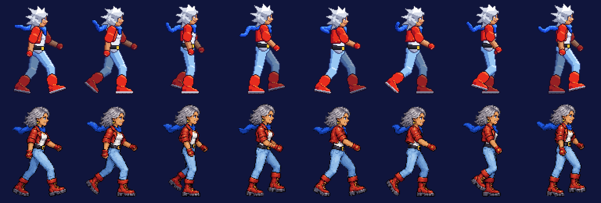
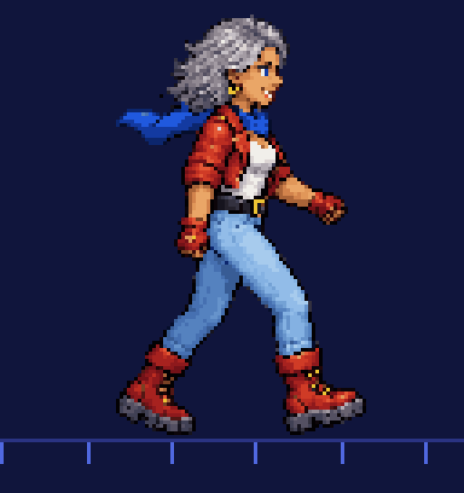

# 워크 사이클 스프라이트

뼈대로 찍어내던 걷기 캐릭터를 대신할 픽셀 스프라이트입니다.
참고 이미지(`reference/character_ref.png`)의 캐릭터를 옆모습으로 옮긴 **걷기 8장 + 정지 1장**이고,
원본 리그와 칸 크기·기준점·포즈가 같아서 그대로 바꿔 끼울 수 있습니다.





## 파일

| 파일 | 내용 |
| --- | --- |
| `assets/sheet_walk8_idle1_128.png` | 걷기 8칸 + 정지 1칸, 1152×128, 투명 배경. 게임에 쓰는 본 파일 |
| `assets/walk_strip_128.png` | 걷기 8칸만, 1024×128 |
| `assets/frames/walk_0.png` … `walk_7.png`, `idle.png` | 낱장, 각 128×128 |
| `assets/sheet_walk8_idle1_128@4x.png` | 위 시트를 4배로 키운 보기용 |
| `assets/sheet_walk8_idle1_hd512.png` | 생성 원화를 정리만 한 고해상도 판(칸 512×512). 머리 통일·팔레트 정리는 들어가지 않음 |
| `assets/walk_preview.gif`, `assets/walk_inplace_transparent.gif` | 미리보기 |
| `assets/sprites.json` | 칸 크기, 기준점, 프레임 이름, 팔레트 42색 |
| `sprite-skin.js` | 원본 페이지에 끼우는 스크립트(스프라이트 내장) |
| `source/` | 이미지 생성 결과 원본 두 장 |
| `reference/` | 캐릭터 참고 이미지와, 생성에 넣은 포즈 가이드 |
| `prompts.md` | 생성에 쓴 프롬프트와 설정 |
| `tools/` | 가이드 제작 → 후처리 → 스킨·미리보기 제작 스크립트 |

## 규격

- 한 칸 128×128, 오른쪽을 보는 방향. 왼쪽은 좌우로 뒤집어 씁니다.
- 기준점은 골반 바로 아래 지면 `(64, 120)`. 발바닥이 y=120 선에 닿습니다.
- 프레임 순서: 접지 → 하강 → 통과 → 상승 (가까운 발), 접지 → 하강 → 통과 → 상승 (먼 발), 정지.
- 한 주기에 93.33px 나아가는 걸음입니다(프레임당 11.67px). 초당 0.95주기면 프레임당 약 132ms.
  이 속도로 움직이면 프레임이 바뀌는 순간마다 딛은 발이 같은 자리에 놓입니다.
- 접지·하강에서 낮고 통과·상승에서 높아지는 3px 상하 움직임이 프레임에 들어 있습니다.
- 색은 공용 팔레트 42색, 알파는 0 또는 255 뿐입니다.

## 원본 페이지에 끼우기

`character.js` 바로 다음 줄에 한 줄을 추가합니다.

```html
<script src="character.js"></script>
<script src="sprite-skin.js"></script>
```

`Character.render` 가 리그 그림 대신 스프라이트를 찍습니다. 걸음 위상, 속도, 뼈대 보기는 원본 리그를 그대로 씁니다.
`Character.spriteSkin.enabled = false` 로 원본 그림으로 돌아갑니다.

시트만 직접 쓸 때는 `i` 번째 프레임을 `sx = i * 128` 에서 128×128로 잘라, 기준점이 캐릭터 발밑에 오도록 그리면 됩니다.

## 원본과 달라지는 점

- 그림이 8장이라 프레임 사이는 보간되지 않습니다. 한 장이 유지되는 동안은 딛은 발이 조금 밀립니다.
- 스카프와 머리카락은 물리 대신 프레임에 그려 넣었습니다. 돌아설 때 스카프가 넘어가는 움직임은 없습니다.
- 걷기 8장은 머리가 같은 그림입니다(얼굴이 깜빡이지 않도록). 머리카락 끝만 한 박자 늦게 1px 처집니다.
- 멈춤과 걷기 사이의 중간 보폭은 없습니다. 속도가 느리면 정지 포즈, 빠르면 걷기입니다.

## 만든 과정

1. 원본 리그로 걷기 8프레임과 정지 포즈를 뽑아 4×2 포즈 가이드를 만든다 (`tools/rig_frames.js`, `tools/make_pose_guide.py`).
2. 가이드를 편집 대상으로, 참고 이미지를 디자인으로 넣어 OpenAI 이미지 편집으로 다시 그린다 (`prompts.md`).
3. 후처리한다 (`tools/build_sprites.py`): 알파 정리, 머리 위치 정합, 리그의 상하 움직임에 맞춘 키 보정,
   4배 → 1배 축소와 공용 팔레트, 걷기 프레임 머리 통일, 정지 포즈 재킷 색 맞춤.
4. 스킨과 미리보기를 만든다 (`tools/make_skin.py`, `tools/make_preview.py`).

```bash
node tools/rig_frames.js <character.js 경로> /tmp/rig
python3 tools/build_sprites.py source/walk_sheet_ai_raw.png source/idle_sheet_ai_raw.png 5 assets
python3 tools/make_skin.py assets sprite-skin.js
python3 tools/make_preview.py assets /tmp/rig
```

`character.js` 는 원본 페이지의 파일이라 이 저장소에는 넣지 않았습니다.
